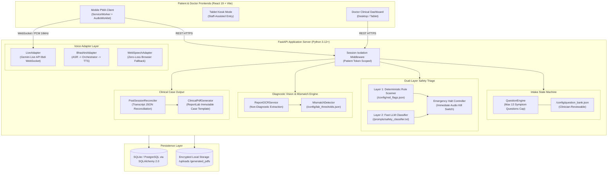

# AyushIntake Architecture & System Design



---

## 1. Patient State Machine Lifecycle

```
[INITIATED] -> [CONSENT_ACCEPTED] -> [VITALS_ENTERED] -> [INTERVIEW_ACTIVE]
       |                                                         |
       |                                           (Red Flag Detected)
       |                                                         v
       |                                                [EMERGENCY_HALT]
       v                                                         |
[COMPLETED] <----------------------------------------------------+
       |
       v
[DOCTOR_APPROVED] -> [PDF_STAMPED_AND_DOWNLOADABLE]
```

1. **Initiation (`initiated`):** Patient logs in with phone OTP or scans hospital QR code. Generates a unique, non-guessable `patient_token` (`AYUSH-XXXXX`). All subsequent database operations strictly scope to this token.
2. **Consent (`consent_accepted`):** Delivers plain-language DPDP Act 2023 disclosure. Supports guardian/caregiver mode. Progress is blocked until accepted.
3. **Vitals & Diagnostic Upload (`vitals_entered`):** Patient inputs height and weight. BMI is computed strictly in code (`weight_kg / (height_m)^2`) and tagged as `"self-reported"`. Report photos or PDFs are uploaded and parsed in memory.
4. **Emergency Screening First:** The very first intake question checks for acute danger signs.
5. **Adaptive Voice Intake (`interview_active`):** Enforces sequence: Pre-existing -> Allergies -> Current Medicines -> Family History -> Symptoms (capped at 13 questions maximum) -> Optional Lifestyle.
6. **Emergency Halt (`emergency_halt`):** If any transcript chunk matches `/config/red_flags.json` or the LLM danger classifier, audio output halts immediately, a calm instruction screen is presented, and a critical alert is queued for clinic staff.
7. **Patient Review:** Patient reviews what was understood per section using large Yes/No icon buttons.
8. **Completion & Queue:** Moves session to `completed`. Post-session reconciliation generates a 5-line AI summary.
9. **Doctor Approval (`doctor_approved`):** Doctor evaluates patient in-person, performs inline audited edits, adds notes, stamps approval, and triggers ReportLab PDF export.

---

## 2. Voice Adapter Specification

```
                +-------------------------------------------+
                |           <<interface>>                   |
                |           VoiceAdapter                    |
                +-------------------------------------------+
                | + connect(session_id, lang, callbacks)   |
                | + send_audio_chunk(pcm_16k_bytes)         |
                | + send_text_input(text)                   |
                | + interrupt()                             |
                | + close()                                 |
                +-------------------------------------------+
                       ^              ^              ^
                       |              |              |
         +-------------+              |              +-------------+
         |                            |                            |
+------------------+        +-------------------+        +---------------------+
|   LiveAdapter    |        |  BhashiniAdapter  |        |  WebSpeechAdapter   |
+------------------+        +-------------------+        +---------------------+
| Gemini Live API  |        | Cascaded Pipeline |        | Local Speech Synth  |
| 16kHz PCM stream |        | Indian languages  |        | & Recognition API   |
| Function calling |        | Offline stubbed   |        | Zero data-loss      |
+------------------+        +-------------------+        +---------------------+
```

### LiveAdapter Function Calling Declarations
- `get_next_question()`: Retrieves next clinician-validated question from backend engine.
- `record_answer(field, value, confidence, quote)`: Writes structured field with provenance.
- `flag_unclear(field)`: Marks field unclear after one clarification attempt.
- `end_section()`: Advances to the next section.
